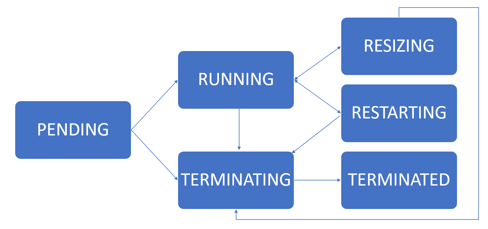

# Image Conversion Test

This fixture checks that DocMaker preserves standard Markdown image URLs and alternative text.

## Inline Image

Here is an image referenced with standard markdown syntax:

## Text After Image

The generated HTML should keep the image URL and alternative text.